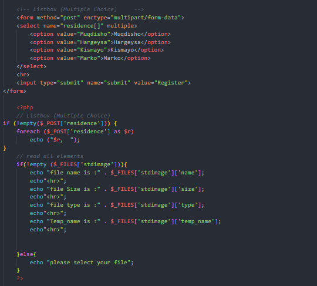
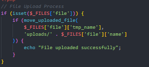
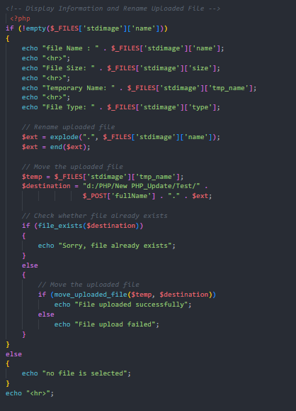
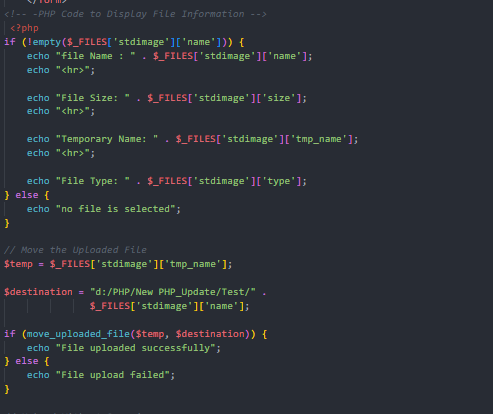
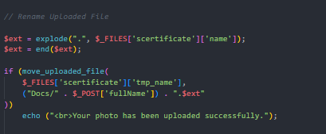
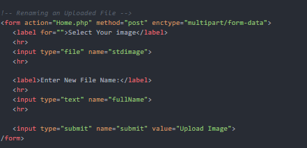
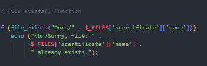
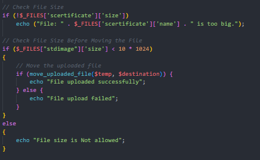
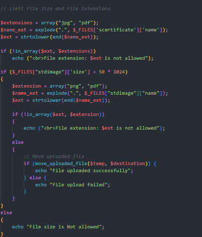
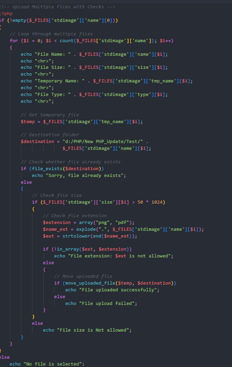

# Week Five Screenshots

This folder contains screenshots of the PHP file-upload examples in Week Five. Each section describes the screenshot using its exact filename.

## `List_Box.png`

Shows a multiple-choice listbox. The `multiple` attribute allows the user to select more than one option, and the `residence[]` name allows PHP to receive the selected values as an array. The related example in `../Home.php` uses `foreach` to display the selected places.

## `Form_For_UploadingImage.png`

Shows an HTML form with a file input for selecting an image and a submit button. File-upload forms normally need `method="post"` and `enctype="multipart/form-data"` so the selected file can be sent to PHP.

## `File_Upload_Process.png`

Illustrates the general file-upload process in PHP: receive the uploaded file through `$_FILES`, then use `move_uploaded_file()` to move it from its temporary location to a destination folder.

## `Display_upload_files.png`

Shows an example related to displaying information about an uploaded file. PHP can read properties such as the original filename, file size, MIME type, and temporary path from the `$_FILES` array.

## `Display_Files_Information.png`

Shows the file information that PHP can display after a file is selected, including its name, size, temporary name, and type. The related code in `../Home.php` checks whether a filename is present before displaying these values.

## `Create_Uploaded_File.png`

Shows the step where an uploaded file is moved to a chosen destination. In PHP, `move_uploaded_file()` is used to move a valid uploaded file from its temporary location.

## `Rename_Upload_Files.png`

Shows the idea of renaming an uploaded file. The example asks for a new name and combines it with the original file extension so that the file type is retained.

## `Renaming_Upload_files.png`

Shows another example of renaming a file during upload. The code can extract the extension from the original filename and use the requested name when building the destination filename.

## `File_Exists_Function.png`

Shows the use of PHP's `file_exists()` function to check whether a file is already present at the destination. This can help prevent an upload from unintentionally overwriting an existing file.

## `Check_File_Size.png`

Shows checking the size of an uploaded file before moving it. PHP provides the file size through `$_FILES['fieldname']['size']`, measured in bytes.

## `Limited_File_SizeAnd_Extenction.png`

Shows how to restrict uploads by file size and file extension. The example uses an allowed-extension list and compares it with the uploaded file's extension. In a real application, file type and size should be validated carefully on the server.

## `Upload_MUltipleFiles_With_Checks.png`

Shows the idea of uploading multiple files and checking each file in a loop. PHP represents multiple uploaded files as arrays, so the code can loop through the filenames and inspect each file's size, type, and temporary path separately.

## Related PHP File

- [`../Home.php`](../Home.php) — contains the Week Five examples for listboxes, file information, uploading, renaming, checking file existence, validating size/extensions, and handling multiple files.
